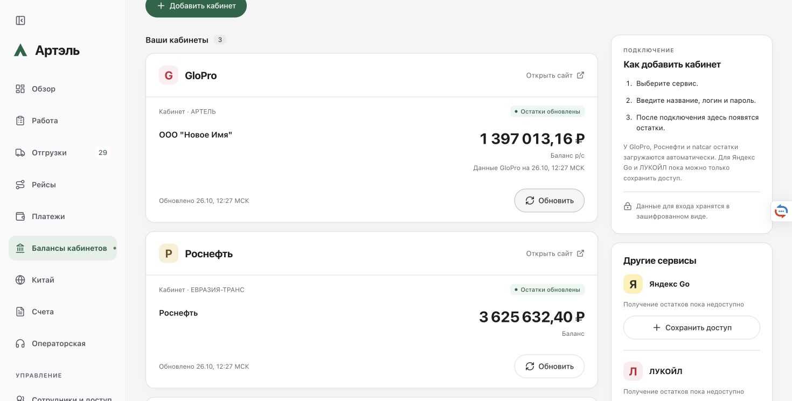

# Балансы кабинетов и производительность CRM — 26.10.2026

Опубликован `artel-crm:20261026-cabinet-performance-9fd5ad54` поверх актуального `20261026-saby-carrier-id-34176855`. Сервер healthy, у нового контейнера перезапусков 0. Все восемь файлов выпуска наложены на точный архив текущего сервера; посторонние изменения сохранены. Commit/push не выполнялись.

## Расхождение GloPro

На пользовательских скриншотах сводка GloPro показывала **897 013,16 ₽**, CRM — **1 397 013,16 ₽**. Разница — 500 000 ₽.

Проверка существующего авторизованного браузера подтвердила старую сумму в сводке даже после перезагрузки страницы. Карточка того же поставщика и договора в GloPro показывала 1 397 013,16 ₽ с текущим временем. Отдельный штатный вход с сервера подтвердил ту же сумму.

В HTML сводки найден штатный запрос `POST /dashboard/get-suppliers-contracts-balances`. Его чтение с `refresh=1` вернуло **1 397 013,16 ₽**; после этого обычная сводка в браузере тоже показала эту сумму. Следовательно, расхождение вызвано устаревшим кэшем сводки GloPro. Источник CRM — карточка договора — в этой проверке был актуален. Причина конкретного изменения суммы на стороне поставщика не устанавливалась; версия про кредитный лимит не подтверждена.

Формулу и суммы CRM не меняли, фиксированную поправку 500 000 ₽ не вводили. На сервер опубликованы:

- время данных самого GloPro рядом с балансом;
- проверка давности исходного снимка: успешная загрузка данных старше 10 минут больше не получает зелёный статус;
- устранение лишнего чтения всей базы при GET кабинетов и после ручного обновления, с сохранением проверки доступа по тому же свежему снимку.

Авторизованный Chrome подтвердил 1 397 013,16 ₽ и новое время источника. Ручное обновление завершилось успешно; дата данных и получения обновились до 12:27 МСК.

## Аудит остальных подключений

Отдельные серверные чтения 12:17 МСК сверены с сохранёнными данными CRM:

- Национальный перевозчик: все три выбранные организации, состав счетов, знаки и суммы совпали точно.
- Роснефть: основной баланс 3 625 632,40 ₽, договор и все три составляющие совпали точно. На момент проверки собственные средства 3 629 332,70 ₽, блокировка 0 ₽, неснижаемый остаток 3 700,30 ₽.
- Яндекс Go и ЛУКОЙЛ в интерфейсе честно остаются без автоматического получения остатков; работающей интеграцией не объявляются.

Платежи, договоры, реквизиты и доступы поставщиков не изменялись. Пароли, ключи и cookie не публиковались, браузерные cookie на сервер не переносились.

## Почему CRM медленная

На сервере 3 915 MiB RAM. В начале проверки доступно 1 864 MiB, memory pressure — 0; существенного обмена со swap не наблюдалось. Диск: 44 GiB свободно. CRM уже выделены 1 GiB RAM, 2 CPU и V8 heap 640 MiB после изменения 24 октября. Лимиты сохранены, тариф не менялся.

До выпуска средняя загрузка CRM за 30,7 секунды — **144,5% одного ядра**, максимум памяти в окне — **554,1 MiB**. Нехватка RAM не подтверждена.

20-секундный профиль исполняющегося процесса показал основные затраты:

- чтение/разбор хранилища — около 3,1 с;
- декодирование строк при чтении — 2,5 с;
- сборка мусора — 2,8 с;
- кодирование хранилища — 1,1 с;
- сборка рабочего снимка — 1,0 с, плюс расчёты взаиморасчётов и Decimal;
- создание форматтера московской даты — 0,9 с.

Вся база размером примерно 5,76 MB многократно читается и разбирается целиком. Фоновые проверки, в том числе проверки доступа в обмене Saby, используют тот же процесс и создают рабочие снимки с расчётами. Это конкурирует с пользовательскими запросами за CPU и вызывает частую сборку мусора. Недостаток оперативной памяти сейчас не является доказанной причиной задержек.

Изменены чтение через Buffer с побайтным сравнением и повторным использованием проверенной строки, обновление кэша после собственной атомарной записи и повторное использование форматтера даты. Каждый запрос по-прежнему читает актуальные байты файла; права не кэшируются по времени/mtime. Каждый вызывающий получает независимый объект. Дата не кэшируется и меняется в московскую полночь. Финансовые формулы и расписания провайдеров не менялись.

На одной и той же серверной копии, в изолированных контейнерах без сети и с одинаковыми лимитами, медианы десяти измерений после прогрева:

| Проверка | До | После |
|---|---:|---:|
| Чтение хранилища | 93,5 мс | 75,2 мс |
| Подготовка рабочего снимка | 131,8 мс | 122,7 мс |
| Чтение + рабочий снимок | 272,9 мс | 202,8 мс |

Последний сценарий ускорился на **25,7%**. SHA-256 результата совпал, копия базы осталась точной. Это измерение конкретной серверной операции, не скорости всех экранов CRM.

**Общая нагрузка после выпуска остаётся высокой.** Два окна показали 146,0% и 139,2% CPU; максимум RAM 552,6/573,3 MiB. Медиана внутреннего health до выпуска 75,8 мс, после 97,4/226,8 мс; все ответы 200. Эти окна не доказывают общего ускорения сайта. Фоновая обработка продолжалась; полного устранения задержек не заявляем. Следующее направление — сокращение повторных полных расчётов в фоновых проверках и отделение тяжёлой фоновой работы от пользовательских запросов. Такое изменение требует отдельной проверки эквивалентности доступа, сумм и протокола Saby.

## Проверки и сохранность выпуска

698 API + 3 банковских теста, 36 целевых проверок, TypeScript, ESLint и обе сборки прошли. Целевые тесты включают отзыв доступа, внешнюю замену файла с тем же размером/mtime, повреждение checksum, независимость объектов, большую Unicode-базу, московскую полночь и давность балансов.

Chromium и WebKit: исходники и готовая сборка, 320/1440 px, показ времени, устаревший статус, ручное обновление, неизменность суммы и отсутствие переполнения. Основная рабочая папка: scoped merge сохранил посторонние правки, TypeScript, 36 тестов и четыре браузерных сценария прошли.

Оба серверных образа прошли семь групп изолированных проверок; копия текущей базы загружена точно, внешних запросов 0. Переключение выполнено со штатными блокировками, проверенным backup и чистой остановкой. Публичные 38 файлов и 9 маршрутов проверены.

Сырые результаты не переписаны: после переключения strict=false/4, после UI strict=false/38. Независимая классификация обеих фаз — true: факты CRM, банковские записи, аккаунты, документы/разрешения Saby и защищённые настройки сохранены; отличались служебные поля фоновой работы. Worker не перезапускался, его постоянные файлы прежние, менялся nonce bridge. Соседние сервисы прежние. Ключ просмотра паролей и увеличенные лимиты ресурсов сохранены. Полная побайтная неизменность всего работающего хранилища не заявляется.

## Диагностический инцидент

До выпуска завершение CPU-профилирования вызвало ошибку `ERR_VM_DYNAMIC_IMPORT_CALLBACK_MISSING`: команда закрытия диагностического inspector использовала dynamic import в контексте, который его не поддерживал. Это ошибка команды агента. Старый контейнер автоматически перезапустился один раз и восстановил healthy. Пользователь уведомлён в ходе работы. Повторное профилирование этой командой не выполнялось. У нового контейнера restart=0.

Непосредственного атомарного снимка перед этим диагностическим перезапуском нет. Дополнительная сверка более широкого интервала от предыдущего выпуска сохранила исходный результат с 605 требующими рассмотрения дельтами: в интервале менялись справочники, заявки, сеансы, банковские служебные данные и Saby. Их нельзя приписать перезапуску или объявить все объяснёнными. Общая побайтная сохранность этого широкого интервала не доказана. Успешная сверка публикации выше относится к отдельному, точно зафиксированному интервалу переключения и UI.

Ручных Create/Prepare/Execute и восстановления старых данных не было. Закрытые исходные доказательства и backup находятся на сервере.

## Материалы

- Выпуск и приватные доказательства: `/opt/artel-crm/releases/20261026-cabinet-performance-9fd5ad54/`.
- Диагностика: `/opt/artel-crm/diagnostics/cabinet-performance-20261026/` и CPU-профиль в `/opt/artel-crm/diagnostics/`.
- Локальная подготовка: `.local/cabinet-performance-20261026/`.
- Публичные технические доказательства без секретов: `docs/assets/cabinet-performance-20261026/`.

