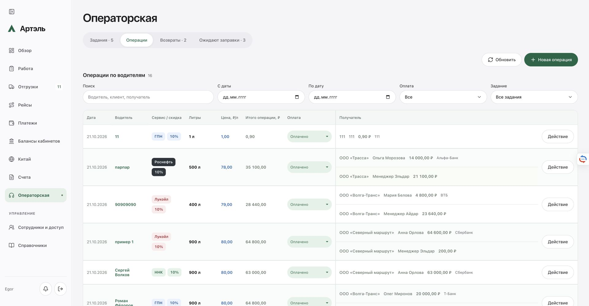

# Независимый аудит операторской и три исправления — 21.10.2026

Опубликован **`artel-crm:20261021-operator-audit-7bad1751`**, финальная проверка **22:57:57 МСК**: healthy, 0 restart. База заново проверена перед сборкой и под блокировками перед переключением: `operator-money-3c794937`. Commit/push не выполнялись. Основной app-код не менялся; работа выполнена в `/Users/mustafa/.codex/worktrees/operator-money-allocation/Artel-CRM`.

## Что изменено

1. В банковской части строки журнала осталось только название банка. Клиент каждой строки, имя получателя и сумма сохранены. Карты, счета, телефоны и дополнительные реквизиты в журнал не выводятся; сохранённые данные не удалены. В просмотре операции добавлен открытый блок **«Сохранённые получатели и реквизиты»** с исходным снимком.
2. Селектор и действие оплаты сразу отправляют сохранение без второго подтверждения. Значение до подтверждённого чтения остаётся прежним. Общая синхронная блокировка защищает от повторного клика. Потерянный ответ оставляет кнопку проверки тем же телом запроса и idempotency key; конфликт перечитывает актуальное состояние. Права, версия, история и серверные финансовые защиты сохранены. Подтверждения удаления, возврата, заправки и закрытия несохранённой формы не менялись.
3. Выбор оплаты имеет радиус 999px и нулевую рамку. Цвета статусов сохранены, клавиатурный фокус — синяя обводка 3px. Исправлено перекрытие этих правил общими стилями, включая мобильный WebKit.

Аудит дополнительно обнаружил и исправил отсутствие проверки версии **исключаемого вторичного задания** при редактировании межплановой операции. Теперь форма передаёт версии затронутых заданий; отсутствующая/устаревшая версия исключаемого задания даёт 409 до любой записи. Также устранено отсутствие полного сохранённого текста дополнительных реквизитов в просмотре операции.

Все текущие 16 операций production — V3. Для старого V2, где имя и реквизиты хранятся одним свободным текстом, журнал показывает «Получатель — в подробностях»: надёжно выделить имя и банк из произвольной строки нельзя. Полный текст сохранён в форме/подробностях; миграция или переоценка истории не выполнялась. Legacy со структурированным `recipient` сохраняет имя и банк. Это явная граница отображения старого формата.

## Доказательства и области проверки

- **API**: новый полный запуск [674 API + 3 bank](assets/operator-audit-20261021/full-tests-final.log); отдельно [61 целевой API/unit](assets/operator-audit-20261021/operator-tests-final.log). Все записи синтетические, временные хранилища, внешние провайдеры отключены.
- **UI-S**: [35 проверок и 8 axe на исходниках](assets/operator-audit-20261021/ui-source.json), Chromium/WebKit.
- **UI-B**: [35 проверок и 8 axe окончательного production bundle](assets/operator-audit-20261021/ui-built.json), плюс [94 проверки карточек и 92 axe](assets/operator-audit-20261021/cases-ui.json). Итого UI-S + UI-B: 164 проверки, 108 axe, ошибок/нарушений 0. Bundle/frontend SHA записаны в доказательствах.
- **LIVE**: [авторизованный Chrome/Egor](assets/operator-audit-20261021/authenticated-ui-proof.json): чтение, несохраняемая форма, 0 деловых записей. [Точные снимки страницы](assets/operator-audit-20261021/screenshot-supplement.json); первоначальные снимки нативного окна, обрезавшие искусственно расширенный viewport, сохранены отдельно в локальном `production-ui/native-captures/`.
- [Lint](assets/operator-audit-20261021/lint.log), TypeScript и [production build](assets/operator-audit-20261021/build.log) — PASS. [Оба Linux-образа](assets/operator-audit-20261021/image-proof.json): по 7 групп, `--network none`, без production mounts. [Копия актуального store](assets/operator-audit-20261021/compatibility-final.log): full data exact, 16 операций/13 cases, 0 внешних запросов.

Исторические PASS предыдущего отчёта не использованы как доказательства этого аудита. Тесты этого запуска и отдельные исходные отказы сохранены в `.local/operator-audit/`.

## Матрица требований: расчёты и API

В этой таблице PASS относится только к синтетическому API/сохранённому хранилищу. Запись перечисленных сценариев в production **НЕ ПРОВЕРЕНА намеренно**, согласно поручению.

| Пункт | Ожидаемый результат | Фактический результат | Статус | Доказательство |
|---|---|---|---|---|
| A1 | 100л × 80 × 90% = 7200; 900л × 90 × 90% − 7200 = 65700 | `creditedAmount=7200.00`, сумма 65700.00; исходная операция прежняя | PASS | [API audit A/E](assets/operator-audit-20261021/operator-tests-final.log), [UI-B](assets/operator-audit-20261021/ui-built.json) |
| A2 | При другой цене и скидке старые деньги не переоценивать | Новый сервис 5%, 900 × 100 × 95% − 7200 = 78300; кредит прежний | PASS | [API audit A/E](assets/operator-audit-20261021/operator-tests-final.log) |
| A3 | 3000 из 7200 оставляет 4200; копейки и исчерпание точны | Расход 3000 → 4200, затем 4199.99 → 0.01, затем 0.01 → 0.00; следующий расход отклонён, store exact | PASS | [API audit A/E](assets/operator-audit-20261021/operator-tests-final.log) |
| A4 | Не тратить дважды и не превышать доступный остаток | Replay без второго settlement, конфликт/превышение без записи | PASS | [money carryover + operator cases](assets/operator-audit-20261021/operator-tests-final.log) |
| A5 | Возврат, ожидание, повторный перенос без двойной суммы | Частичное исполнение 900→800→100; перенос старых 50 в новые 900; повторный перенос новых 900 без старого долга | PASS | [operator cases: deferred/credits/partial fuel](assets/operator-audit-20261021/operator-tests-final.log) |
| A6 | Старые записи/история читаются без переоценки; перезагрузка сохраняет | Старые байты/precision и история читаются; новый экземпляр store совпадает; production-копия full data exact | PASS | [API](assets/operator-audit-20261021/operator-tests-final.log), [копия store](assets/operator-audit-20261021/compatibility-final.log) |
| B1 | 230000 + 20000 первому, 10000 второму | Оба плана, снимки клиента и суммы строк сохранены; итоги 250000 и 10000 | PASS | [audit B/D](assets/operator-audit-20261021/operator-tests-final.log) |
| B2 | 240000 + 10000 первому, 20000 второму | Итоги 250000 и 20000, одна операция и два назначения | PASS | [audit B/D](assets/operator-audit-20261021/operator-tests-final.log) |
| B3 | Редактирование/удаление пересчитывают все затронутые задания | Правка на 5000/25000 пересчитала оба; удаление вернуло исходные итоги без двойного освобождения | PASS | [audit B/D](assets/operator-audit-20261021/operator-tests-final.log) |
| B4 | Устаревшая версия любого задания отклоняет всю запись | Первичный/вторичный/исключаемый план: 409, полный store до/после равен; актуальная версия исключаемого плана проходит | PASS | [audit B + прежние concurrent tests](assets/operator-audit-20261021/operator-tests-final.log) |
| C1 | Менеджер до заполнения всех четырёх реквизитов | Первые два получателя из четырёх + Эльдар 30 ₽ сохранены, оставшиеся не использованы | PASS | [audit C](assets/operator-audit-20261021/operator-tests-final.log) |
| C2 | Менеджер первой/средней/последней строкой, отдельно | Все четыре порядка проходят, включая несколько заданий | PASS | [audit C](assets/operator-audit-20261021/operator-tests-final.log) |
| C3 | Все строки точно равны операции; отрицательные/недостающие копейки запрещены | Суммы 30.03 и 60.00 точны; 30.04 при распределении 30.03 и отрицательные значения дают 400, store exact | PASS | [audit C](assets/operator-audit-20261021/operator-tests-final.log) |
| C4 | Сохранить фактическую семантику «Распределено» | Итоги плана учитывают только обычных получателей; переводы менеджеру отдельно. Новым согласованным правилом это не объявляется | PASS | [audit C](assets/operator-audit-20261021/operator-tests-final.log), [индекс](assets/operator-audit-20261021/optimization.json) |
| D1 | Лимит 250000, распределено 270000, остаток −20000; продолжать выполненное | 270000.00 / −20000.00, status completed, последующее +1 разрешено | PASS | [audit B/D](assets/operator-audit-20261021/operator-tests-final.log) |
| D2 | Превышение реквизита и точное достижение лимита разрешены | Единственный реквизит 250000 принимает итог 270000; точное достижение 250000 проходит | PASS | [audit B/D](assets/operator-audit-20261021/operator-tests-final.log) |
| D3 | Лимит не блокирует; денежный остаток и равенство распределений защищены | Перераспределение разрешено; overdraw даёт 409, mismatch — 400 без частичного сохранения | PASS | [audit A/E, C](assets/operator-audit-20261021/operator-tests-final.log) |
| E1 | Оплата/снятие сохраняют историю и переживают reload | Чередующаяся история с актором/временем, store и reload сохраняют статус | PASS | [API](assets/operator-audit-20261021/operator-tests-final.log), [UI-B](assets/operator-audit-20261021/ui-built.json) |
| E2 | Права, версия и финансовые данные защищены после снятия | 403 без доступа, 409 при старой версии; поля денег/литров/цен/получателей/связей exact, cases exact, защищённая правка с остатком отклоняется | PASS | [audit A/E + auth/CSRF tests](assets/operator-audit-20261021/operator-tests-final.log) |
| O1 | Индекс совпадает с независимым простым эталоном | 200 plan IDs, 10002 операции (включая legacy/V2), 20000 строк, менеджеры, удаления, правки и excludeId — точное совпадение | PASS | [benchmark/assertions](assets/operator-audit-20261021/optimization.json) |

Индекс в этом выпуске не изменён. Новый ограниченный benchmark: медиана **4.68 мс** для индекса и **42.72 мс** для простого эталона, около **9.1×** на указанной синтетике. Это не сравнение скорости всей CRM, не production-замер и не утверждение ускорения относительно прежнего выпуска: набор содержит менеджеров/удалённые и старые записи и отличается от прежнего benchmark 4.1×.

## Матрица интерфейса

| Пункт | Ожидаемый результат | Фактический результат | Статус | Доказательство |
|---|---|---|---|---|
| 1/F | Только банк в банковской части строки; данные сохранены | V3/legacy выводят bank, карты/телефон/details отсутствуют; подробности содержат исходный текст | PASS | [UI-B](assets/operator-audit-20261021/ui-built.json), [LIVE](assets/operator-audit-20261021/authenticated-ui-proof.json), [точное сравнение банка со store](assets/operator-audit-20261021/cabinet-detail-supplement.json) |
| 2/E | Оба направления селектора и меню без второго подтверждения | Chromium/WebKit, desktop/mobile: сохранение и read-back, диалога подтверждения нет | PASS | [UI-B](assets/operator-audit-20261021/ui-built.json) |
| E3 | Повторный клик не повторяет запрос | При задержке 500 мс disabled, прежнее значение; повторный change — один PATCH | PASS | [UI-B](assets/operator-audit-20261021/ui-built.json) |
| E4 | Потерянный ответ не даёт ложный успех/дублирование истории | Ответ после фактической записи оборван; прежнее значение и блокировка; повтор точно того же body/key, одна запись истории | PASS | [UI-B](assets/operator-audit-20261021/ui-built.json) |
| E5 | Конфликт перечитывает действительный статус | Между чтением и кликом другая синтетическая запись; 409, alert и актуальный статус; reload сохраняет | PASS | [UI-B](assets/operator-audit-20261021/ui-built.json) |
| 3/F | Закругление, нет чёрной рамки, видимый клавиатурный фокус | border 0px, radius 999px, outline 3px, focus-visible true, 108 axe без нарушений | PASS | [UI-B](assets/operator-audit-20261021/ui-built.json), [LIVE](assets/operator-audit-20261021/authenticated-ui-proof.json) |
| B/F | Клиент у каждого получателя; фильтр по обоим заданиям, без дубликата | Строки Северный маршрут / Волга Транс / менеджер; операция видна ровно один раз в каждом фильтре | PASS | [UI-B](assets/operator-audit-20261021/ui-built.json) |
| F1 | Дата отдельно, водитель отдельно, нет case-меток/общего столбца клиента | Точный набор 9 заголовков; меток cases под водителем нет | PASS | [UI-B](assets/operator-audit-20261021/ui-built.json), [LIVE](assets/operator-audit-20261021/authenticated-ui-proof.json) |
| F2 | Клиент/имя/сумма/банк вдоль строки, «Действие» справа; длинный текст доступен | Длинные имена/банки перенесены; desktop имеет локальную прокрутку, mobile — карточки; глобального переполнения нет | PASS | [UI-B](assets/operator-audit-20261021/ui-built.json), [mobile](assets/operator-audit-20261021/built-chromium-390.png) |
| F3 | Цена синяя/600, литры чёрные/700 | Проверены вычисленные стили и живой снимок | PASS | [UI-B](assets/operator-audit-20261021/ui-built.json), [LIVE screenshot](assets/operator-audit-20261021/journal-1920.png) |
| F4 | Нет нижних таблиц cases; карточки, история и действия доступны | Открытые/выполненные возвраты/ожидания; drawers, действия и формы без сохранения, Escape/focus/scroll восстановлены | PASS | [UI-B cases](assets/operator-audit-20261021/cases-ui.json), [LIVE](assets/operator-audit-20261021/authenticated-ui-proof.json) |
| F5 | Ширины 320/390/600/1100/1470/1920, нет переполнения страницы | Все шесть ширин пройдены Chromium/WebKit и живым Chrome; точечные формы/клавиатура/axe | PASS | [UI-B](assets/operator-audit-20261021/ui-built.json), [cases](assets/operator-audit-20261021/cases-ui.json), [LIVE](assets/operator-audit-20261021/authenticated-ui-proof.json) |
| LIVE расчёт | Несохранённая форма 7200→65700 | Под Egor credit=7200.00, due=65700.00, закрыто «Не сохранять» | PASS | [LIVE](assets/operator-audit-20261021/authenticated-ui-proof.json) |
| LIVE запись оплаты/ошибки сети | Не менять реальные записи ради проверки | Не выполнялось; заменено синтетическим API/UI, не выдано за live write proof | НЕ ПРОВЕРЕНО | [LIVE границы](assets/operator-audit-20261021/authenticated-ui-proof.json) |
| Физический Safari/iPhone/Huawei | Проверка реального устройства | Playwright WebKit проверен; физические устройства не проверены | НЕ ПРОВЕРЕНО | [UI-B](assets/operator-audit-20261021/ui-built.json) |

## Сохранность и публикация

Созданы обычный backup и проверенный [остановленный backup](assets/operator-audit-20261021/stopped-backup-proof.json). Три блокировки, повторная сверка image/backend/archive/manifest. Переключена только CRM. [Public](assets/operator-audit-20261021/public-proof.json): 37 файлов, 9 маршрутов, secret scan PASS. Recovery — тот же новый код; старый backend и данные не возвращались.

| Инвариант | После переключения | После живого UI |
|---|---|---|
| Исходный strictDataEqual | false | false |
| Исходные необъяснённые дельты CRM | 4 | 75 |
| Независимая классификация, до отдельного разбора | 0 | 2 |
| После узкого документированного разбора | 0 | 0 |
| Операторская, версии, факты, справочники/аккаунты | exact | exact |
| Банковские операции по стабильным ID | 481 + 409 + 468 exact | 481 + 409 + 468 exact |
| Workflow-документы/подписи/разрешения Saby | true | true |
| Worker, соседи, постоянные файлы счетов/PDF | сохранены | сохранены |

[Исходная независимая классификация](assets/operator-audit-20261021/final-independent-classification.json) сохранена. 4/73 банковские сырые дельты разобраны сравнением по стабильным ID/датам: сохранённые операции и дни не менялись, перестановки/служебные polling-поля объяснены. Остальные классифицированные дельты — точные polling/scheduler/revision-поля. Bridge менял только проверенный nonce-журнал, identity/revocations прежние. Saby №27/30 не продолжались, Reserve/Prepare/Execute не вызывались.

**Две новые дельты после UI не игнорировались по аналогии с прошлым выпуском.** Это `details/0/amountMinor` и `details/1/amountMinor` одного подключения Роснефти. [Отдельное доказательство](assets/operator-audit-20261021/cabinet-detail-supplement.json) сверило точные пути/хеши: «Собственные средства» и «Заблокировано» уменьшились одновременно на 3 120 000 коп. каждый. Основной баланс и неснижаемый остаток прежние; до и после выполняется равенство **баланс = собственные − заблокировано − неснижаемый**. Остальные поля подключения, шифрованные credentials, ID счёта и контракт точны, изменились отметки успешного обновления. Код чтения HTML и атомарной записи снимка кабинета побайтно прежний. Это объясняет ограниченную пару изменений снимка, но **инициатор обновления и хозяйственная причина изменения у поставщика не подтверждены**, исходный HTML не сохранён. Исходные `rawStrictDataEqual=false` и `after-ui.allReviewedInvariantsPassed=false` не заменены на true; отдельный узкий вывод относится к сохранности проверяемых инвариантов.

[Финализация](assets/operator-audit-20261021/finalization-proof.json) изменила только метаданные выпуска, зафиксировала эти ограничения и healthy/0restart. Никаких реальных переводов, внешних сообщений или фиктивных деловых записей этот аудит не создавал.

## Воспроизведение и исходные отказы

Из worktree выполнить `npm test`, `npx tsx --test tests/api-operator*.test.ts tests/operator*.test.ts`, `npm run lint`, `npm run build:production`, `node --import tsx scripts/verify_operator_audit_ui.mjs`, затем тот же UI со `ARTEL_OPERATOR_QA_BUILT=1`, `ARTEL_OPERATOR_QA_BUILT=1 node --import tsx scripts/verify_operator_audit_cases_ui.mjs`, `npx tsx scripts/audit_operator_index.ts`. UI/helpers сами создают временные хранилища и не используют production store.

В `.local/operator-audit/` сохранены исходные отказы: неверная фикстура произвольной скидки (сервер правильно её отверг; добавлен синтетический сервис 5%), конфликт CSS рамки/фокуса/WebKit, отсутствие реквизитов в просмотре, успешная запись без версии исключаемого задания (200 вместо ожидаемого 409). Последние два дефекта исправлены и воспроизведения стали PASS. Старый тест геометрии предполагал неизменное расположение мобильных статусов рядом с toolbar; фактически опубликованная адаптивная схема переносит toolbar при нехватке места. Новый тест проверяет оба допустимых расположения, отсутствие пересечения и сохранённый порядок; интерфейс ради старого теста не изменялся. Исторические файлы доказательств не переписаны.

Изменено 13 файлов, из них два `server/operator*`; остальные 102 server-файла точны. Source archive/manifest и все release helpers: `/opt/artel-crm/releases/20261021-operator-audit-7bad1751`. Локальные доказательства: `.local/operator-audit/`. Источники основной папки и посторонняя работа сохранены.

- Image ID: `sha256:1d6ed544b30d9c11b7ac7e687a6110d7ac8c9becc34c1b27c2fa9061a775b555`.
- Backend SHA: `f115da76db4135463af5f73eef91bc72be1c0dd11835d856f16d5c5164812654`.
- Config SHA: `ff962e4113c2d0873e3429fb07f1c17c698790c388615ac2a061db3abf2e5c17`.

Следующий выпуск строить от этого архива после новой проверки live drift. Старый backend поверх денежных зачётов, межплановых записей и Saby не возвращать.

- Source archive SHA: `8671e252c7287e54c785e0e068cb5bbe3a41c0da2c8141a08595597f329c6496`.
- Source manifest SHA: `cc5ecab62215a925550cdf26ebbc3f2f6a62052810bbaebb0d90179c16b740e2`.
