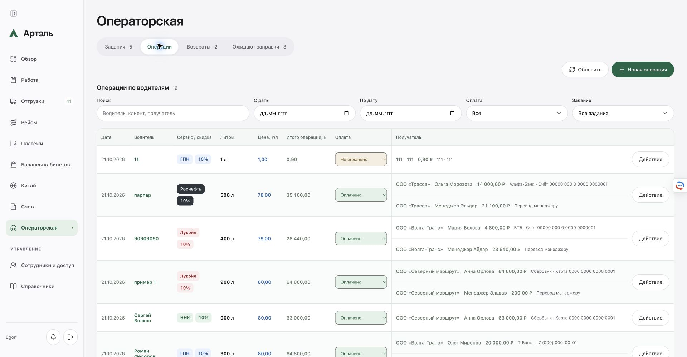

# Денежные остатки и распределение операторской

Опубликовано и проверено **21.10.2026, 22:12:06 МСК**: `artel-crm:20261021-operator-money-3c794937`, healthy, 0 restart. Chrome/Egor подтверждён. Проверки на живом сайте не создавали и не меняли деловые записи.

## Изменения

- Новый зачёт остатка выполняется в рублях по сохранённой исходной стоимости. Прежние 100 л при 80 ₽ и скидке 10% дают 7 200 ₽. Новые 900 л при 90 ₽ и скидке 10%: 72 900 − 7 200 = **65 700 ₽ к оплате**. В форме теперь «Сумма из остатка, ₽».
- Одна операция распределяется между получателями разных заданий. Каждая строка хранит свой план и снимок клиента. Версии всех затронутых заданий проверяются и обновляются атомарно. Сумма распределений должна совпадать с суммой операции.
- Менеджеру можно направить любую часть на любом этапе; допустима операция только с менеджером. Исчерпывать реквизиты перед этим не требуется.
- Превышение общего лимита и лимита реквизита разрешено. Выполненные задания доступны для нового распределения. Остаток может быть отрицательным. Сохранено прежнее разделение учёта: «Распределено» плана суммирует реквизиты, переводы менеджеру учитываются отдельно.
- Оплата переключается в обе стороны через выбор в журнале или «Действие». Подтверждение и история сохранены. Снятие оплаты не удаляет возвраты/зачёты. Финансовое редактирование и удаление операций с зависимыми остатками защищены.
- Старые записи не пересчитывались. Прежние литровые зачёты читаются как раньше; новые сохраняют денежную оценку. Частичный расход уменьшает сохранённую сумму и соответствующую долю исходного объёма. Повторный расход сверх доступного остатка запрещён.

Дата и водитель разделены. Метки возврата/ожидания под водителем убраны. Клиент задания находится у каждого получателя; имя, сумма, банк и реквизиты расположены вдоль строки, действие справа. Цена синяя (600), литры чёрные (700). На мобильном экране используются карточки, на промежуточных ширинах таблица прокручивается внутри контейнера.

В возвратах и ожиданиях убраны нижние таблицы; сохранены карточки и «Открытые»/«Выполненные».

## Проверки и оптимизация

- Lint, TypeScript, production build — PASS.
- Полный npm test: **670 API + 3 bank** PASS. После заключительных защит валидации — **57 целевых тестов** PASS. Первый отказ из-за отсутствующей локальной XLSX-фикстуры сохранён; после копирования фикстуры из основной папки отдельные 13 тестов и повторный полный запуск прошли.
- Chromium/WebKit на исходном сервере и окончательном production bundle: **62 проверки, 8 axe**, ошибок и нарушений 0. Проверены денежный зачёт при новой цене, частичный расход, два задания, менеджер, превышение лимита, обратная оплата и адаптивность 320/390/600/1100/1470/1920.
- Основной и recovery Linux-образы с одним кодом: по 7 изолированных групп, без production volumes и сети. Public: 37 файлов, 9 маршрутов, secret scan PASS.
- Окончательный код загрузил копию текущего store: 16 операций, 13 cases, **полный data exact**, внешних запросов 0. Два первоначальных отказа прав доступа сохранены; исправлены права только изолированной копии, живые данные не затронуты.
- Chrome/Egor: новый журнал, цвета, расчёт 7 200 → 65 700 ₽, менеджер до реквизитов, другое задание для следующего получателя, обратная оплата до подтверждения, меню действий, открытые/выполненные cases. Пробный ввод закрыт без сохранения. Проверены мобильные 320/390 и desktop 1920, размер окна восстановлен.
- Подсчёт использования планов переведён на один индекс по операциям. Синтетический замер: 200 планов, 10 000 операций, 20 000 распределений — **16,30 мс вместо 67,42 мс, около 4,1×**, суммы точны. Это ускорение конкретного расчёта, не замер скорости всей CRM.

## Выпуск и сохранность

Свежая база перед переключением: `work-refresh-09cfde39`. Архивы, manifest, image и backend проверены под тремя блокировками. Сделаны обычный backup и проверенный остановленный backup. Перезапущена только CRM; worker и соседи прежние.

| Проверка | После выпуска | После UI |
|---|---:|---:|
| Исходный strictDataEqual | false | false |
| Исходные необъяснённые дельты CRM | 0 | 2 |
| Необъяснённые после отдельного разбора | 0 | 0 |
| Операторская и деловые факты | exact | exact |
| Банковские операции | 1358 exact | 1358 exact |

Две дельты после UI — exchangeStage существующих Saby №28/29: carrier_action_required → carrier_details_required. Отдельный `workflow-display-supplement.json` проверил точные пути/хеши, прежние remote code 4 и carrierFill saved, совпадение всех документов, подписей, разрешений и истории за исключением двух display-стадий и точных polling-полей. Это соответствует неизменённому циклу фоновой проверки: промежуточный sabyOrderProgress, затем уточнение заполнения перевозчика. Исходные workflowDocumentsAndAuthorizationUnchanged=false и allReviewedInvariantsPassed=false фазы UI **сохранены**, отдельный supplement их не переписывает.

У worker изменился только проверенный журнал nonce; identity/revocations прежние. №27/30 не запускались. Успешная отправка Saby не заявляется.

Промежуточные пакеты bf9d3b6d и 018b5cbe не переключались в production: старые smoke-ожидания запрещали новое допустимое превышение/отрицательный остаток. Ожидания исправлены, финальные проверки прошли, исходные отказы сохранены.

## Исходники и продолжение

Изменено 16 файлов, из них четыре server/operator*. Остальные 100 server-файлов точны относительно production-базы. Основной app-код и посторонние изменения сохранены. Commit/push не выполнялись.

- Worktree: `/Users/mustafa/.codex/worktrees/operator-money-allocation/Artel-CRM`.
- Локальные доказательства: `.local/money-release/`, UI — `.local/money-release/production-ui/`.
- Серверный каталог: `/opt/artel-crm/releases/20261021-operator-money-3c794937`.
- Image: `sha256:b2802a23558ca3ffa42a08115c3b407c88b836a3233dcc86a8409e1b9198a8c2`.
- Backend: `81fee7a5673d4bff18b2f30128e9fc95eefc4e1f70bcbc70977aabc0c771e058`.
- Source archive: `d508eb3b2bc0c0b1358771a0cc74612c9e8aed71ec7c61f4e60d25012d539891`.
- Source manifest: `2c50bb020cd647a9471d3efbc470096a4b328d60885813b0ccb30182aa3713d4`.

Следующий выпуск собирать от этого archive/manifest после свежей сверки live drift. **Старый backend не возвращать поверх новых денежных зачётов и межплановых распределений.** Ограничения Saby по неизвестным Reserve/Execute и блокировке повторного старта остаются в силе.
