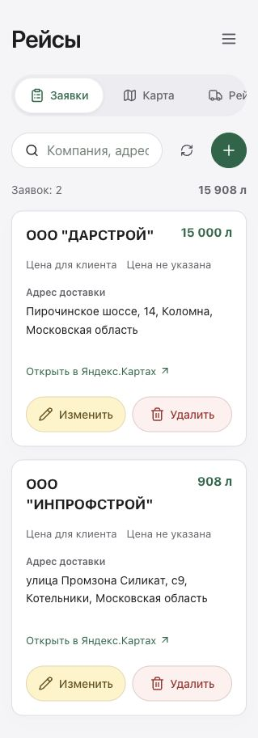
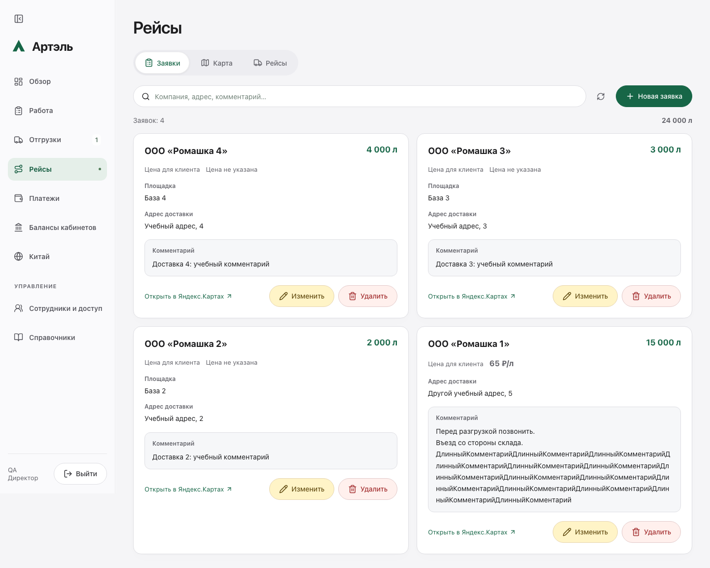

# Цена за литр в карточке заявки — 17.10.2026

Опубликовано в **15:41:17 МСК**: `artel-crm:20261017-request-card-price-fab6eb0f` поверх `artel-crm:20261017-request-price-44ad9917`. Изменение также перенесено в основной локальный checkout. Commit/push не выполнялись.

## Результат

Под заголовком карточки заявки отображается «Цена для клиента» и значение в ₽/л, например **65 ₽/л**. Если цена отсутствует, показано «Цена не указана». Поддерживается русское форматирование и до шести десятичных знаков, как в существующей цене рейса.

Изменены только два файла приложения: `web/src/TripRequestsPanel.tsx` и `web/src/trip-requests.css`. Сохранение цены и перенос в рейс остаются из предыдущего выпуска. Backend побайтно прежний; Сатурн/ЭТрН не затронуты. Посторонние локальные правки сохранены.

## Проверки

- ESLint, TypeScript и production build на точном исходном коде выпуска прошли; после переноса в основной checkout lint/TypeScript также прошли.
- Повторно прошли 18 групп существующего сценария Chromium/WebKit, ширины 320/390/768/1440 px. Проверены формы, сохранение и перенос цены в рейс; снимки карточек с 65 ₽/л и без цены отдельно просмотрены на 320/1440 px.
- Полный API-набор не повторялся: backend идентичен предыдущему проверенному выпуску. Оба собранных образа прошли изолированные smoke/entrypoint проверки, включая цену после перезапуска.
- 36 публичных файлов совпали с проверенной сборкой; 12 HTTPS-маршрутов дали ожидаемые статусы. Публичная сборка проверена на приватные значения.
- Авторизованная проверка рабочего сайта подтвердила новую строку в обеих существующих заявках. У обеих цена отсутствует, поэтому видна надпись «Цена не указана». Рабочие заявки для числового примера не изменялись. Первоначальный сетевой таймаут преодолён открытием новой вкладки; сессия пользователя сохранилась.
- Финальный контейнер `artel-crm-crm-1`: нужный образ, healthy.

## Сохранность и откат

Backup: `/opt/artel-crm/backups/artel-crm-20261017T124106.728203Z.tar.gz`.

При переключении **allPassed=true, dataPreservationPassed=true**. После браузерной проверки исходные строгие флаги **allPassed=false, dataPreservationPassed=false** сохранены: фоновое чтение изменило один остаток кабинета, отметки обновлений, служебный revision/push и создало штатное задание банковского опроса. Остаток не объявляется неизменным. Дополнительная проверка сохранённых снимков классифицировала задание по его схеме и времени запуска; необъяснённых изменений осталось 0. Исходные результаты не перезаписывались.

Заявки, рейсы №17/23/24/25, workflow Saby, документы/подписи, ЭТрН, банковские операции, права/настройки и остальные защищённые данные сохранены. Новых деловых записей при проверке нет. Повторного развёртывания или восстановления данных не выполнялось.

Backend SHA-256: `237482297a2af9491457037d8695c0076a7db54549cc3591a5a1afe354a12cbb`.
Source manifest SHA-256: `feb69c8a853520b561fb98eecfb67979cf0c0dbd27df91d41541d6f52eb7b36f`.

UI-откат: `artel-crm:20261017-request-card-price-fab6eb0f-ui-rollback` — прежний интерфейс, тот же backend. Рабочие данные ради отката интерфейса не восстанавливать.

Серверные доказательства: `/opt/artel-crm/releases/20261017-request-card-price-fab6eb0f`.
Локальные приватные доказательства: `/Users/mustafa/Library/Application Support/Artel-CRM/private/request-card-price-20261017`.
