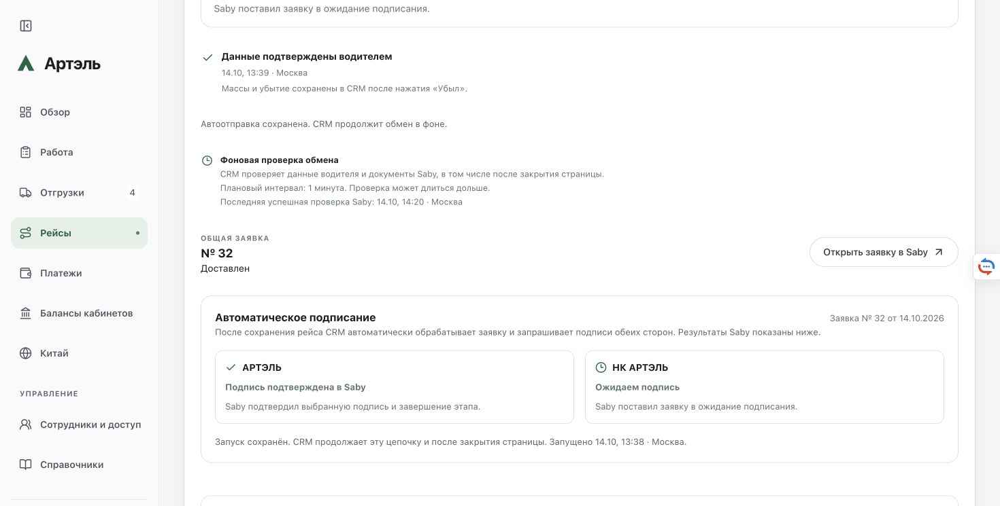

# Подписание при отсутствии координат в Saby — 14.10.2026

Исправление опубликовано в 14:13:59 МСК. На 14:20 МСК в авторизованной CRM у рейса №23 / заявки Saby №32 подпись АРТЭЛЬ подтверждена, этапы 3–4 завершены; НК АРТЭЛЬ ожидает подпись. Полное завершение обеих подписей и последующих ЭТрН этим отчётом не заявляется.

## Поручение и установленная причина

Пользователь подтвердил продолжение без координат в Saby, **если полный адрес совпадает**, затем уточнил: вернуть поведение подписания по примеру рейса №17. Координаты и бизнес-данные не изменялись, формат сериализации координат оставлен прежним.

Скриншот относится к рейсу CRM №23, заявке Saby №32 (`63f3e6c7-f350-4cf6-906c-424cda3f5cbf`). В сохранённом XML CRM у разгрузки есть точка, а в подготовленном XML Saby элемент `Коорд` отсутствует. Полный адрес «улица Промзона Силикат, с9, Котельники, Московская область» совпадает. Это отсутствие поля, а не другая точка или округление. Причина, по которой Saby убрал поле, не установлена.

Старый компаратор считал отсутствие координат изменением маршрута и блокировал документ после Prepare, до первого Execute. Сохранённый manifest имел `preparedVerified=false`, `dispatchState=not_sent`, без `executeAttempted`; действующее разрешение автоматического запуска уже существовало.

Для сравнения read-only проверен рейс №17 / Saby №25 (`55745021-479a-43ba-89c5-64ee89e3b99a`): координат нет в исходном и текущем маршруте, адресная сверка проходит, обе подписи в CRM подтверждены, Saby возвращает завершённое состояние 7. Старый документ не переподготавливался и не переподписывался.

## Изменение

Изменены только два серверных файла и их тесты:

- `server/saby-order-evidence.ts`: отсутствие координат разрешается в известных узлах маршрута только при одной корректной исходной паре и точном совпадении единственного непустого полного адреса. Исключение применяется к разобранной копии для сравнения; исходный XML, snapshot и точка CRM сохраняются. Различающиеся присутствующие координаты, адрес или остальные сведения по-прежнему блокируют продолжение.
- `server/trip-saby-signing.ts`: возобновляется только конкретная остановка по координатам с исходным неотправленным manifest, без попытки Execute, с совпадающими документом, редакцией, attempt/payload, сохранённым автоматическим разрешением и нетронутым этапом перевозчика. Перед первым Execute повторно проверяются точные файлы, бизнес-данные, этап, сертификат и доступ. Повторного Prepare и сброса истории нет. Неизвестный результат внешней записи не повторяется.
- `tests/saby-order-evidence.test.ts` и `tests/api-trip-saby-signing.test.ts`: разрешённый адресный сценарий и ограничения восстановления.

Правило общее, без специальных номеров рейсов. Поэтому продолжились также ранее разрешённые и остановленные по той же причине цепочки №24/Saby31 и №25/Saby33. Новые заявки или рейсы исследователь не создавал, кнопку запуска повторно не нажимал. Отправку продолжил штатный серверный обработчик по ранее сохранённым разрешениям.

## Проверки и выпуск

- 518 API-тестов и 111 целевых тестов прошли; также прошли lint, TypeScript и production build.
- Независимое ревью окончательных четырёх файлов не выявило блокирующих замечаний.
- Основной и совместимый UI-rollback образы прошли изолированные проверки и проверку блокировки хранилища.
- UI побайтно прежний. Новый синтетический браузерный тест кандидата не заявляется: сохранён прежний UI proof и отдельно выполнена реальная авторизованная проверка после выпуска.
- Проверены 14 публичных файлов, HTTPS-ресурсы и 12 маршрутов. Контейнер healthy.

Релиз: `artel-crm:20261014-saby-coordinate-dcea2104` поверх `artel-crm:20261013-saby-start19-reconcile-4e4f2d8c`.

- Image ID: `sha256:577a9ad3aef45c290e771867bca1daaa8f52da7d6beb24ff087b3bb9782c2906`.
- Backend SHA-256: `265ad4424678cd6a3afddc4102aa9f33638d07305ca069f89084efd07875e9bb`.
- Source manifest SHA-256: `8d307c9eb1b9c7f6b63bfb303bbecb68b58f775b4753ad0ba53b5686ca529bf2`.
- Backup до переключения, при работающем сервисе: `/opt/artel-crm/backups/artel-crm-20261014T111348.754857Z.tar.gz`.
- Серверные доказательства: `/opt/artel-crm/releases/20261014-saby-coordinate-dcea2104`.
- Локальные приватные доказательства: `/Users/mustafa/Library/Application Support/Artel-CRM/private/saby-coordinate-20261014`.

Четыре файла перенесены из изолированного проверенного source в основной checkout после сверки исходных версий. Посторонние изменения сохранены. Commit/push не выполнялись. Доступы, сеть, ключи подписи и настройки провайдеров не менялись.

## Реальный результат

В 14:14:36–42 МСК заявка №32 перешла из блокировки в `waiting / acknowledged`, с проверенным прежним manifest и отметкой первого Execute. В 14:17:01 read-only чтение Saby подтвердило состояние 4 «Доставлен», «Ожидается утверждение» и одну подпись исходного вложения.

При этом сохранены:

- Редакция `7e1454af-d3c0-4ec0-8ddc-5f892432d09b` и вложение `8ce5a4f0-4598-4800-aa2c-596f487e128b`.
- SHA-256 XML Saby `19f565ebbb46875cb9635b1d93b6e187f8330f17697ff34f8c233e6996da52b7`.
- SHA-256 исходного XML CRM `c8c6503c0c0dc8738412ee87e13eaf36cd40bcfcce6fb795687be9b954e3be32`.

В 14:20 авторизованный Chrome показал «Подпись подтверждена в Saby» для АРТЭЛЬ, сохранённые данные водителя/машины и «Ожидаем подпись» для НК АРТЭЛЬ. Блокировки по координатам нет. Проверка выполнялась чтением; финальные наблюдения сделаны в отдельной вкладке, чтобы не мешать открытой пользователем форме.

## Сохранность и границы доказательств

Непосредственно при выпуске `dataPreservationPassed=true`; строгий `allPassed=false` только из-за активного штатного lease. После работы фоновых обработчиков исходные after-UI `strictAllPassed=false` и `strictDataPreservationPassed=false` сохранены без переписывания результата.

Независимая сверка зафиксированных before/after-UI снимков подтверждает точное сохранение учётных записей, компаний, справочников, отгрузок, прогресса водителей, распределений платежей, заявок, реестров создания и нумерации, разделов «Работа» и «Китай». Состав рейсов в этих снимках: №17/23/24/25. Точки CRM, адреса, массы, факты водителя, исходные snapshot/payload/attempt, разрешения запуска и идентичности документов всех четырёх рейсов сохранены.

Для №23/24/25 неизменны sender binding и prepared manifest; в снимке отражены ожидаемые переходы `blocked → waiting`, `not_sent → acknowledged`, отметка первого Execute и добавление события истории. Позднейшее подтверждение подписи АРТЭЛЬ установлено отдельно чтением Saby и браузером.

У №17 весь блок signing побайтно одинаков по каноническому SHA-256 `99d923a1346890a993d6ab607a49df5d6f103d7e447779ba819e431244e1f3cb`. Однако весь workflow не объявляется неизменным: фоновое чтение очистило `carrierEvidence`, изменило наблюдаемый `exchangeStage` с `carrier_confirmed` на `carrier_confirmation_pending`, а диагностическое состояние отправки ЭТрН — с `blocked` на `unknown`; также изменились ошибка и время проверки. Сохранённые подписи и исходные документы не потеряны. Причина этих фоновых диагностических изменений отдельно в данном исправлении не устранялась.

Все 1182 ранее существовавшие банковские операции (419 + 355 + 408) сохранены при сопоставлении по ID, без добавленных, удалённых или изменённых деловых строк. Дневные остатки двух Sber-интеграций (по 44 строки) совпадают по дате. Большой общий diff включает перестановку массивов и отметки чтения. В кабинетах один реальный остаток обновился при фоновом чтении и не объявляется прежним. Сырые снимки/секреты в репозиторий не переносились.

Изменившийся остаток относится к natcar; остальные поля счёта совпадают, обновление сопровождается новой отметкой успешного чтения. В push изменился только `lastRunAt`. Прежняя история всех цепочек сохранена. Необъяснённых дельт в независимой классификации нет.

Подробная независимая сверка: приватные `independent-saved-preservation-audit.json`, `independent-saved-bank-and-transition-audit.json` и итоговый `independent-saved-audit-summary.json`. Этот отчёт не заменяет исходные строгие отказы утверждением «всё неизменно» и не доказывает завершение подписи НК или этапов 6–7.
