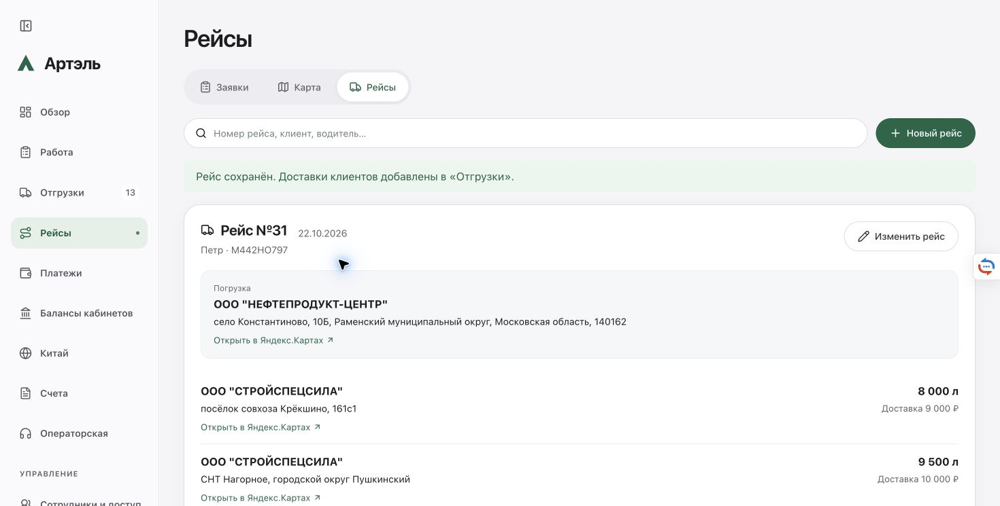

# Новый рейс №31 — 22.10.2026

По уточнению пользователя создан отдельный новый рейс с данными №30. Агент заполнил форму; финальное сохранение произошло в общей вкладке без агентского нажатия Save. Результат подтверждён интерфейсом и production read-back.

№31: `shipment-trip-064adc49-4568-4c24-b1bf-c647d36049b0`, дата 22.10.2026, план 11:43 МСК. Две доставки 8000/9500 л. Клиент, поставщик, нефтебаза, товар, менеджер, адреса, цены, водитель, машина и флаги документов совпадают с №30. Это две новые учётные строки, прежние сохранены.

Известные массы №30 — 6,745/7,985 т — не записаны как новое водительское действие. Новый рейс: masses null, driverProgress отсутствует, loadingActorMode sender, automation waiting_departure, direct attempt отсутствует, документов 0. Все прежние shipment records, водительские факты и полный etrn №30 совпадают с исходным снимком.

Создание/подписание/отправка ЭТрН пока не проверены. Следующий штатный шаг — подтверждение водителя. В backend остаётся DIRECT_ETRN_NUMBER_BLOCKER: создание прямой ЭТрН без подтверждённого номера Saby остановится в exchangePreparedEtrn. Новая карточка это ограничение не устраняет.

Свежая read-only сверка старых документов в 11:40:28 МСК: №2 теперь «В обработке», один T1/1110339 с одной подписью выбранного сертификата и идентификатором ГИС ЭПД. Подпись скачана, локальная криптографическая проверка не выполнялась. №3 остаётся неподписанным черновиком. Прежнее утверждение об отсутствии подписи №2 устарело. Provider/store writes при этой сверке 0; старую цепочку не продолжали.

Приватные доказательства: `/opt/artel-crm/ops/native30-postresume-read-20261022-recreate/evidence/observations`. Production image прежний `artel-crm:20261022-saby-direct-stages-ed2e41b2`; деплоя и commit/push нет.

[Проверка данных](assets/trip31-20261022/new-trip-proof.json)

Update 22.10 after 12:19 MSK: driver confirmed masses 6.745/7.985 t. Real Saby document No.4 created; signing blocked after Saby changed the redirection method. [Current outcome](trip31-saby-numbering-2026-10-22.md).
