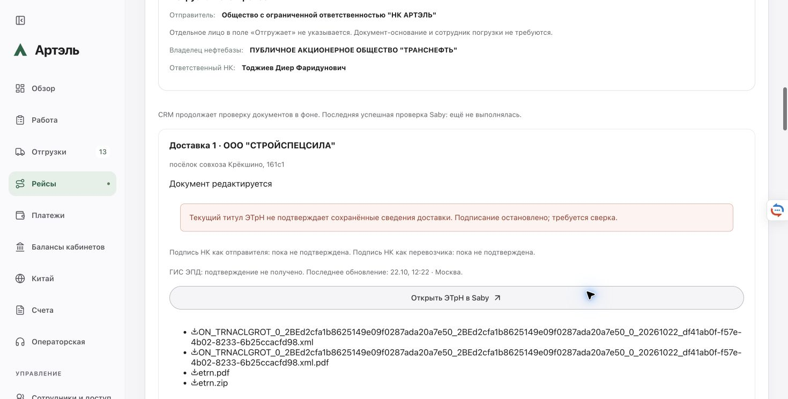

# Рейс №31: массы и нумерация Saby — 22.10.2026

Запрос пользователя: внести известные массы и устранить ограничение получения номера прямой ЭТрН для проверки создания через CRM.

В начале работы production уже содержал массы 6,745 т для 8 000 л и 7,985 т для 9 500 л (14,73 т всего). Водительские прибытие/убытие — 11:44:38/11:44:52 МСК. Повторной записи масс и новых водительских событий агент не делал. Рейс: `shipment-trip-064adc49-4568-4c24-b1bf-c647d36049b0`; две новые строки ранее созданного №31 сохранены. Старые №27/30 не перезапускались.

## Исправление

CRM отправляет полный неподписанный первый титул без придуманного номера, читает присвоенный Saby номер и сверяет документ, стороны, дату, метку, редакцию и XML. Если Saby оставил исходный титул без номера, разрешено однократное дополнение номера в том же неподписанном документе с сохранением идентификаторов. Подпись допускается лишь после проверки окончательного титула. При потерянном ответе — адресная сверка, без дублирования создания.

Основание: [СБИС.ЗаписатьДокумент](https://saby.ru/help/integration/api/all_methods/doc) описывает автоматическое присвоение пропущенного номера по настройке реестра; [создание транспортной накладной](https://link.sbis.ru/page/kbase_entity/2ecadb1a-5bd4-4858-83f4-74d83eb5735a?folderId=f6d99b24-2393-4782-8f65-16a9e0f9e665) — передачу XML первого титула. Применимость отсутствующего номера именно к прямому T1 проверяется отдельно на провайдере; локальные тесты этого не доказывают.

Первый реальный запрос 12:02:54 МСК вернул в 12:03:05 полный JSON-RPC HTTP 500/-32000: «Не указано имя файла вложения». Исходный serializer формировал имя, но builder не передавал его. Исправлена передача имени для нового протокола senderTitleVersion=2. Исходная неизвестная попытка и её fingerprint сохраняются без изменений.

В 12:05:36 отдельное read-only чтение Saby подтвердило полный пустой список исходящих ЭТрН НК за 22.10 (ЕстьЕще=Нет). Для точного отказа об имени добавлено однократное исправление: необходимы полный ответ с совпавшим RPC ID, точный код/текст, единственная первоначальная попытка, точное воспроизведение SHA/размера исходного запроса и повторная сверка отсутствия по метке. Новая попытка записывается отдельно; старая, grant, attemptId и флаги не сбрасываются. Другие ошибки 500, неполные ответы, неуспешный поиск, несовпадение hash/RPC и исторические резервирования не разрешают повтор.

## Проверки и публикации

- Финальные 686 API + 3 bank, 72 целевых, 100 протокольных; lint, TypeScript, frontend и backend build прошли.
- В обоих образах — 7 изолированных групп, включая реальный production bundle, HTTP/auth, потерю ответа, отсутствие повторного создания/Execute, restart/lock и static HTTP. Сеть провайдера и production mounts отсутствовали.
- Изолированное чтение копии текущей базы: fullDataExact=true, externalRequests=0 для обоих выпусков.
- `20261022-saby-numbering-5c89e130`: первичное создание с потерянным именем файла. Предшествующий 66528c4f не публиковался: старый image-тест ещё требовал запрета любой записи. Его ошибка сохранена; тест обновлён под новый протокол.
- `20261022-saby-filename-f04c9126`: исправление имени и ограниченное продолжение конкретного отказа. База — точный 5c89e130, изменены только server/etrn-service.ts, server/saby-consignment-note.ts, tests/api-nk-direct-etrn.test.ts. Остальные исходники и UI сохранены.
- Первый switch завершился exit1 после успешной активации из-за ожидаемых изменений workflow №31. Raw strict=false и 7 первичных дельт не заменялись true; отдельный классификатор оставил три новых поля №31. Восстановление оставило тот же healthy candidate; старый backend/данные не возвращались.

## Текущий результат

**Подтверждено live:** создана ЭТрН **№4** первой доставки №31, id `2df05287-a56e-4a00-b8d1-7e53ce6c7e76`, редакция `4a704542-9bbd-481d-a1ba-e8a160a8a7a2`. Ответ создания получен в 12:15:27 МСК; номер прочитан из Saby и записан в тот же T1 в 12:16:06. Независимое чтение в 12:16:07: один T1, подписи 0, полная бизнес-сверка XML PASS, SHA `653706a0d837a2fbfb02de8d8bf5ebc50a7e24cb4b4676df444e0f33898b6cb5`.

**Следующая граница:** Prepare заменил `По телефону` на `Электронное уведомление перевозчика о переадресовке`, добавил нативный информационный блок, сменил fileId/время, дополнил координаты нулями и выдал UID ГИС `2e57799d-7226-495a-be8b-77e15e067114`. Чтение в 12:19:04 подтвердило №4/подписи0; бизнес-сверка стала FAIL. Execute0. CRM сохраняет исходные snapshot/grant и останавливает подпись. Пользователю задан вопрос о принятии изменённого условия для №31; ответа пока нет. Вторая ЭТрН ещё не создана: процесс последовательно ждёт завершения первой доставки.

Chrome/Egor сначала показал «Создание ЭТрН 1 из 2» и ссылку на точный документ, после несовпадения текущего T1 снова показывает 0 из 2, сохраняя ссылку и файлы №4. Счётчик зависит от текущего подтверждения содержимого; это не удаление документа. Полное успешное создание двух документов, подпись и отправка не заявлены.

Финальный образ `artel-crm:20261022-saby-filename-f04c9126`, image ID `sha256:1ad992b5b3247f767a37e1a0eed4fb53a8e9f7e92595d41a35119fe244850f51`, healthy/0restart. Второй switch exit0/public38/9, финализация 12:22:07 МСК. Backend SHA `b50711605356d84113ba6e58d63176ec1b8e4fd81edcc4790c684980ef7892e3`. Config SHA `12ec02473044771f8b2ccaff5feb3771a5a04df882d1a3557f074049562d3db5`. Следующая база — его source archive/manifest со свежим live drift; старый backend поверх directDraftCreation/filenameCorrection не возвращать.

Вся цепочка: исходные деловые факты, loadingFacts, события водителя, grant, frozen deliveries и остальные workflows кроме точного polling сохранены. Worker/соседи/постоянные файлы прежние; bridge менял только nonce. Raw strict=false и 7/4/102 первичных дельт сохранены. Первичная общая сверка банков false: между выпусками импортированы две разные операции statement-api, одна также отражена в общем банковском списке. Все 1370 прежних записей сохранены кроме polling; три добавленные записи и соответствующие дневные итоги проверены отдельным supplement. Причина внешних переводов и инициатор refresh независимо не доказаны. Исходные false не переписаны; отдельный итоговый proof подтверждает сохранность исходных данных и классификацию изменений.

Приватные снимки, исходные raw-аудиты, checksums, резервные копии и протокольные квитанции находятся в каталогах двух выпусков `/opt/artel-crm/releases/`. Локальные логи: worktree `.local/numbering31/`. Основной app-код не изменялся; commit/push нет. VPN оставлен включённым; SSH использовал существующий интерфейс Wi-Fi.
